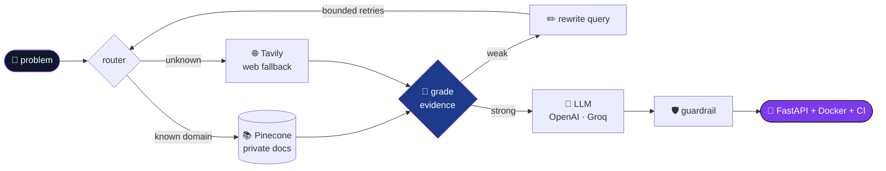

<!-- ═══════════════════════════════════════════════════════════════ -->
<!--                 parth.run()  ·  agent trace v2.6                -->
<!-- ═══════════════════════════════════════════════════════════════ -->

```console
parth@noida:~$ python -m parth --whoami --verbose

[init]      loading profile .................................. ok
[identity]  Parth Chaitanya · B.Tech AI & ML @ Galgotias College of Engg. & Tech.
[role]      AI/ML Engineer (student) · LLM apps · Agentic RAG · Python backends
[mantra]    "AI that works in production, not just in notebooks."
[status]    building RemoteHunt in public ▓▓▓▓▓▓▓▓▓▓▓▓▓░░░ shipping
[open_to]   AI/ML roles · Backend roles · Freelance
[warn]      0 hallucinations detected. guardrails active.
```

---

### 🧠 how my brain routes a problem



<sub>↑ That's literally how my HR Policy Copilot works. Also how I debug.</sub>

---

### 🗂️ stack/

```text
stack/
├── genai/       langgraph · openai · groq · pinecone · tavily · huggingface · rag
├── ml/          scikit-learn · tensorflow · keras · pandas · numpy · matplotlib
├── backend/     python · fastapi · flask · sqlalchemy · oauth2 · java
├── frontend/    react · tailwind · javascript · streamlit · gradio
├── data/        mysql · mongodb · sqlite · pinecone (vector)
└── ship/        docker · github actions · pytest · git
```

---

### 🛰️ nodes deployed

<details open>
<summary><b>🔎 RemoteHunt</b> &nbsp;·&nbsp; <code>status: active</code> &nbsp;·&nbsp; self-hosted AI job-search assistant</summary>
<br/>

```yaml
ingest:    20+ sources (Greenhouse, Lever, Ashby) · API budgets · 429 back-off
pipeline:  dedupe → scam detection → eligibility → MiniLM match scoring   # 6 stages
resume:    0–100 ATS score + truthfulness guardrail
infra:     Gmail OAuth · APScheduler · 60+ pytest tests in CI · runs in <512 MB RAM
stack:     [FastAPI, SQLAlchemy, sentence-transformers, Groq, React, Docker]
```
→ [**repo**](https://github.com/parthchaitanya/remotehunt)
</details>

<details>
<summary><b>🧭 HR Policy Copilot</b> &nbsp;·&nbsp; <code>type: agentic-rag</code> &nbsp;·&nbsp; employee support that refuses to make things up</summary>
<br/>

```yaml
graph:     LangGraph · query routing · LLM evidence grading · query rewriting
safety:    bounded retries to block hallucinated answers
retrieval: private-first on Pinecone · Tavily only as fallback
api:       FastAPI · secured ingestion · SQLite audit trail
stack:     [LangGraph, FastAPI, Pinecone, OpenAI, Tavily, Docker]
```
→ [**repo**](https://github.com/parthchaitanya/Enterprise-HR-Policy-Employee-Support-Agentic-RAG-Copilot)
</details>

<details>
<summary><b>🔥 Forest Fire Index Predictor</b> &nbsp;·&nbsp; <code>R² > 0.98</code></summary>
<br/>

```yaml
data:      5,000+ weather records · 4+ regression algorithms benchmarked
result:    R² > 0.98 · ~22% lower RMSE
serve:     Streamlit dashboard · <1s prediction latency
```
→ [**repo**](https://github.com/parthchaitanya/FFI-Predictor)
</details>

<details>
<summary><b>🏦 Customer Churn Prediction</b> &nbsp;·&nbsp; <code>model: ANN</code></summary>
<br/>

```yaml
model:     TensorFlow/Keras ANN on the Churn Modelling dataset
serve:     Streamlit app for live predictions from customer details
```
→ [**repo**](https://github.com/parthchaitanya/Customer-Churn-Prediction)
</details>

<details>
<summary><b>📰 AI Brochure Generator</b> &nbsp;·&nbsp; <b>💬 Conversational AI Assistant</b></summary>
<br/>

```yaml
brochure:  scrapes a company site → LLM picks relevant pages → streams Markdown brochure
assistant: retail chatbot · real-time streaming via Groq · dynamic system prompts · Gradio
```
→ [**brochure**](https://github.com/parthchaitanya/AI-Company-Brochure-Generator) · [**assistant**](https://github.com/parthchaitanya/Conversational_AI_Assistant)
</details>

---

### 📜 git log --experience

```diff
@@ Program Management Intern · NeGD, Ministry of Electronics & IT · Jun–Jul 2026 @@
+ built an LLM-powered document reader that scores project health from SharePoint data
+ developed a dual-interface portal for Project Managers and developer teams
+ tested 6 government websites end to end: DPDP · LBSNAA · MoSJE · SPORTS · MoTA · UPSC

@@ Technical Coordinator · GeeksforGeeks Campus Body @@
+ organised 2 hackathons
+ reached 500+ students
```

---

### 📡 contact.retrieve()

```json
{
  "status": 200,
  "grade": "relevant",
  "results": {
    "email":    "chaitanyaparth.17@gmail.com",
    "linkedin": "linkedin.com/in/parthchaitanya",
    "x":        "@mtankparth",
    "links":    "linktr.ee/ParthChaitnya"
  },
  "note": "building with LLMs, RAG or Python APIs? let's talk."
}
```

<p align="center">
  
</p>

<p align="center"><sub><code>[exit 0] profile retrieved · evidence graded · answer verified ✔</code></sub></p>
