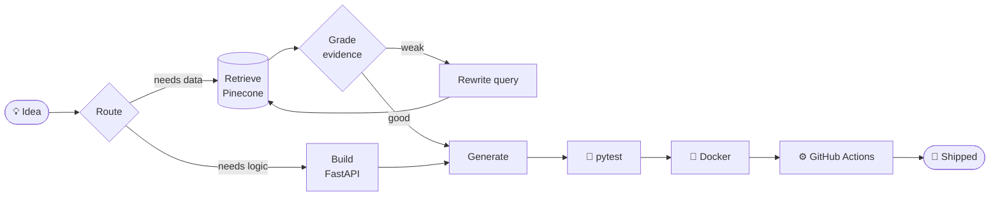

<div align="center">


<a href="https://git.io/typing-svg">
  
</a>

</div>

---

## `~/boot.log`

```console
[  OK  ] Loaded module      : Python, FastAPI, LangGraph, Pinecone
[  OK  ] Mounted            : B.Tech AI & ML @ Galgotias College of Engineering & Technology (2024 → now)
[  OK  ] Started service    : Program Management Intern @ NeGD, MeitY
[  OK  ] Started service    : Technical Coordinator @ GeeksForGeeks CB
[  OK  ] Reached target     : 500+ students engaged, 2 hackathons organized
[ INFO ] Hallucinations     : bounded retries enabled
[ INFO ] Current mode       : build → test → containerize → ship
```

---

## 🧠 My workflow, as an agent graph



---

## 🚀 Deployed services

### 🔎 RemoteHunt: AI Job-Search Assistant &nbsp; [`🌐 Live Demo`](#)
> *Finds the jobs, scores the match, fixes the resume.*

| Component | What it does |
|---|---|
| **Ingestion** | Plugin-based system for 20+ sources (Greenhouse, Lever, Ashby), ~40 company boards, with API budgets, 429 back-off and health checks |
| **Pipeline** | 6 stages: dedupe → scam detection → eligibility → match scoring, ranked by MiniLM similarity, skill overlap and seniority fit |
| **Resume engine** | 0–100 ATS score, LLM suggestions, skill-gap analysis and a **truthfulness guardrail** that blocks fabricated claims |
| **Automation** | Gmail API (OAuth) + APScheduler |
| **Quality** | 60+ pytest tests in CI, public demo running in **<512 MB RAM** |

`Python` `FastAPI` `SQLAlchemy` `sentence-transformers` `Groq` `React` `Tailwind` `Docker` `GitHub Actions`

---

### 🏢 Enterprise HR Policy Copilot: Agentic RAG &nbsp; [`📂 Repo`](#)
> *An agent that says "I don't know" instead of making things up.*

- **LangGraph** workflow: query routing → LLM evidence grading → query rewriting → bounded retries
- **Private-first retrieval** on Pinecone + OpenAI embeddings, answered without falling back to Tavily web search
- **FastAPI** endpoints, secured ingestion, SQLite audit trail, Dockerized, validated on 4 end-to-end scenarios

`LangGraph` `FastAPI` `Pinecone` `OpenAI` `Tavily` `SQLite` `Docker`

---

### 🔥 Forest Fire Index Predictor &nbsp; [`📂 Repo`](#)
> *Benchmarked 4+ algorithms on 5,000+ weather records.*

```diff
+ R² > 0.98
+ ~22% lower RMSE
+ <1s prediction latency in a live Streamlit dashboard
```

`Scikit-learn` `Pandas` `NumPy` `Matplotlib` `Streamlit`

---

## 🏛️ Experience

**Program Management Intern @ NeGD, Ministry of Electronics & IT (MeitY)** `Jun – Jul 2026`
- Built a dual-interface portal (Project Manager + developer views) for project tracking
- Built an LLM-powered document reader that scores project health from SharePoint data
- Tested 6 government websites end to end (DPDP, LBSNAA, MoSJE, SPORTS, MoTA, UPSC) and helped design Suvidha sites

---

## 🧰 Tech stack

<div align="center">


</div>

---

## 📊 Stats

<div align="center">


</div>

---

## 📡 Connect

<div align="center">

[](mailto:chaitanyaparth.17@gmail.com)
[](#)
[](#)

```console
$ echo "Let's build something that doesn't hallucinate."
```


</div>
